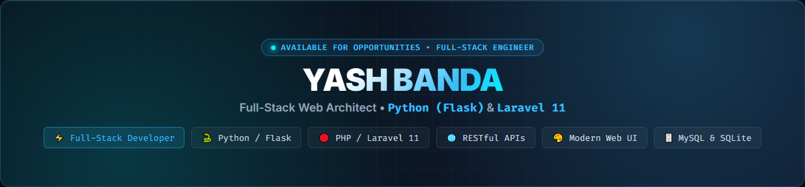

  

&nbsp;&nbsp;

&nbsp;&nbsp;

---

### 🌐 Quick Overview

- 🚀 **Full-Stack Engineering:** Specialized in building robust, performant web platforms with **Python (Flask)** and **PHP (Laravel 11)**.
- ⚡ **Backend & API Architecture:** Designing scalable RESTful APIs, relational schemas, authentication workflows, and service integrations.
- 🎨 **Modern Interface Design:** Building responsive web interfaces, interactive dashboards, and seamless user experiences.
- 🛠️ **Engineering Rigor:** Clean MVC architecture, comprehensive documentation, secure role-based access control (RBAC), and maintainable codebases.

---

### 💻 Technologies & Stack

  

| Domain | Core Technologies |
| :--- | :--- |
| **Backend & APIs** | Python 3, Flask, PHP 8.2+, Laravel 11, RESTful Web Services, Eloquent ORM |
| **Machine Learning & Data** | Scikit-learn, TF-IDF Vectorization, Cosine Similarity, Pandas, NumPy |
| **Frontend & UI** | JavaScript (ES6+), Bootstrap 5, Chart.js, FullCalendar, DataTables, Blade, Jinja2 |
| **Database & Persistence** | MySQL 8.0, SQLite, Schema Migrations, Automated Seeders |
| **DevOps & Tooling** | Git, GitHub, Stripe API Integration, Postman, Vite, Composer, Artisan CLI |

---

### 🚀 Flagship Projects

<table width="100%">
  <tr>
    <td width="50%" valign="top">
      <h4>⚡ <a href="https://github.com/Yashbanda18052003/schedule-manager-web-app">PlanPulse AI</a></h4>
      
<em>AI-Powered Schedule & Productivity Management Platform</em>

      <ul>
        <li>Intelligent Task Parser extracting dates, times & priorities</li>
        <li>Interactive full-page FullCalendar with drag-and-drop rescheduling</li>
        <li>Automated conflict detection engine & daily productivity analytics</li>
        <li>Background SMTP email alerts for upcoming deadlines</li>
      </ul>
      
<code>Python</code> • <code>Flask</code> • <code>Automation</code> • <code>FullCalendar</code> • <code>Chart.js</code> • <code>SQLite</code>

    </td>
    <td width="50%" valign="top">
      <h4>💼 <a href="https://github.com/Yashbanda18052003/job-portal">Job Portal & AI Mock Interview</a></h4>
      
<em>Recruitment Platform with Voice AI & Code IDE</em>

      <ul>
        <li>Real-time browser voice mock interviews with instant AI evaluation</li>
        <li>Embedded 12-language online IDE compiler with automated test cases</li>
        <li>End-to-end applicant tracking (ATS) workflow for recruiters</li>
        <li>Job application pipelines, resume parsing, and candidate scoring</li>
      </ul>
      
<code>Python</code> • <code>Flask</code> • <code>Web Speech API</code> • <code>Online IDE</code> • <code>Bootstrap 5</code>

    </td>
  </tr>
  <tr>
    <td width="50%" valign="top">
      <h4>📚 <a href="https://github.com/Yashbanda18052003/book-rental-system">BookNest</a></h4>
      
<em>Online Book Rental & Library Management Platform</em>

      <ul>
        <li>Dual portal architecture for readers and administrative staff</li>
        <li>Stripe Checkout integration for memberships, rentals & overdue fines</li>
        <li>Queue-based book reservation waitlist with automated fulfillment</li>
        <li>One-click administrative reports export to Excel (.xlsx) and CSV</li>
      </ul>
      
<code>PHP 8.2</code> • <code>Laravel 11</code> • <code>Stripe API</code> • <code>Laravel Excel</code> • <code>DataTables</code>

    </td>
    <td width="50%" valign="top">
      <h4>🎬 <a href="https://github.com/Yashbanda18052003/anime-recommendation-system">Anime Matcher</a></h4>
      
<em>Content-Based Recommendation Engine</em>

      <ul>
        <li>High-accuracy similarity matching using TF-IDF vectorization</li>
        <li>Scikit-learn cosine similarity scoring on thousands of titles</li>
        <li>Instant autocomplete search and dynamic top-10 recommendations</li>
        <li>Clean, responsive modern interface with genre metadata filters</li>
      </ul>
      
<code>Python</code> • <code>Flask</code> • <code>Scikit-learn</code> • <code>Pandas</code> • <code>Machine Learning</code>

    </td>
  </tr>
</table>

---

### 📊 GitHub Activity & Analytics

&nbsp;

  

---

💬 **Let's Connect & Collaborate:**  

&nbsp;

 

*“First, solve the problem. Then, write the code.”* — John Johnson

